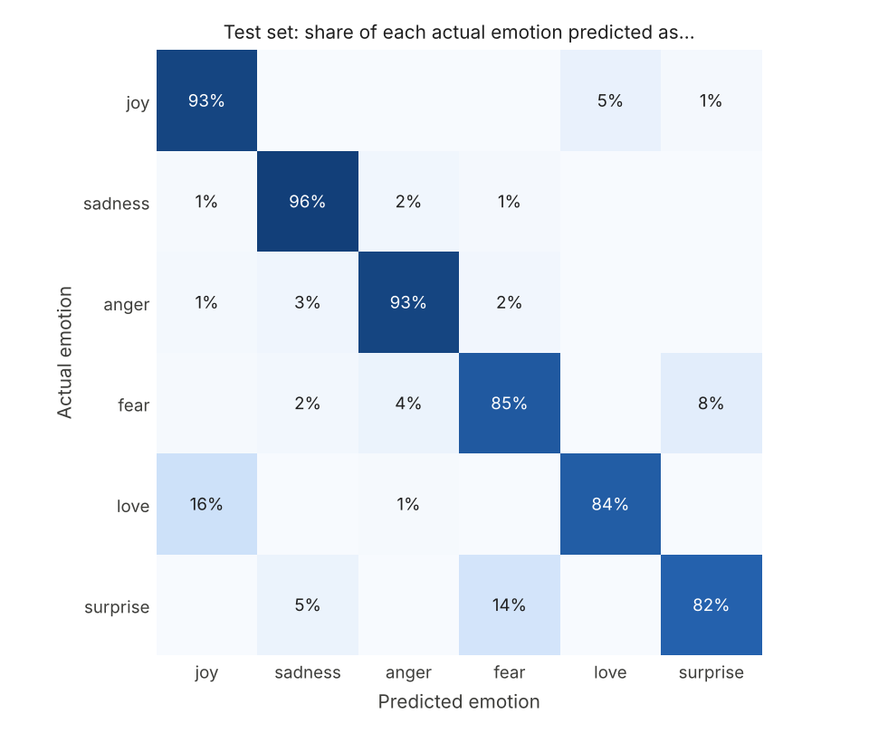

# Mood Detector

An NLP app that reads a short message and predicts the emotion behind it:
**anger, fear, joy, love, sadness, or surprise**.

Built as a team project by **Calvin Rutherford** and **Taylor Unger**
(original repo: [calvin-rutherford/mood-detector](https://github.com/calvin-rutherford/mood-detector)).
Retrained and evaluated on the 20,000-sentence
[dair-ai/emotion](https://huggingface.co/datasets/dair-ai/emotion) dataset, and extended with a
fine-tuned DistilBERT model, by Taylor Unger.

## Results

All v2 and v3 rows are scored on the same official 2,000-sentence test set.

| Version | Model | Training data | Test accuracy | Test macro F1 |
|---|---|---|---|---|
| v1 baseline (`train_baseline.py`) | TF-IDF + logistic regression | 300 hand-labeled sentences | ~0.37 | ~0.34 |
| v2 (`train.py`) | TF-IDF + logistic regression | 18,000 sentences (train + validation) | 0.8925 | 0.8543 |
| v3 (`train_transformer.py`) | DistilBERT, fine-tuned (PyTorch, fp32) | 16,000 sentences (train only) | 0.9215 | 0.8794 |
| **v3, as served by the app** | **DistilBERT, int8 ONNX** | **same model, quantized** | **0.9205** | **0.8765** |

v1 is scored on its own small held-out split, so it is only a rough reference point.

Per-emotion test F1:

| | sadness | joy | anger | fear | love | surprise |
|---|---|---|---|---|---|---|
| TF-IDF (v2) | 0.934 | 0.915 | 0.894 | 0.860 | 0.775 | 0.748 |
| DistilBERT int8 (v3, app) | 0.965 | 0.942 | 0.920 | 0.876 | 0.811 | 0.745 |

Full numbers: [`results/metrics.json`](results/metrics.json) (TF-IDF),
[`results/transformer_metrics.json`](results/transformer_metrics.json) (DistilBERT),
[`results/comparison.json`](results/comparison.json) (size and speed).

### Accuracy vs. size and speed

Measured on the same machine (CPU only, 2 threads) with `compare.py`:

| Model | Size on disk | Time per sentence (one at a time, median) | Throughput (batches of 64) |
|---|---|---|---|
| TF-IDF + logistic regression | 8.3 MB | 0.6 ms | ~34,800 sentences/s |
| DistilBERT, PyTorch fp32 | 267.8 MB | 26.4 ms | ~41 sentences/s |
| DistilBERT, int8 ONNX (app) | 67.4 MB | 5.0 ms | ~114 sentences/s |

**The tradeoffs, honestly:**

- DistilBERT makes 26% fewer mistakes on the test set (159 vs. 215 out of 2,000), with
  accuracy up 2.8 points (0.8925 to 0.9205) and macro F1 up 2.2 points (0.8543 to 0.8765)
  for the int8 model the app serves. The TF-IDF model was also trained on
  2,000 more sentences (train + validation), so the comparison does not favor DistilBERT.
- The cost is size and speed: the int8 DistilBERT is about 8x larger and about 8x slower per
  sentence than TF-IDF, and it needed 42 minutes of CPU training versus under a minute.
  For an interactive app, 5 ms per message is still instant. For scoring millions of
  messages cheaply, TF-IDF is the better tool.
- int8 quantization cut the model from 268 MB to 67 MB and made it about 5x faster than
  PyTorch fp32, for a cost of 0.001 accuracy and 0.003 macro F1 (both versions give the
  same answer on 98.65% of test sentences).
- The gain is not uniform. DistilBERT is clearly better on sadness, joy, anger and love,
  but **surprise did not improve** (F1 0.748 vs. 0.745), and the two confusions noted
  for v2 got worse, not better: love predicted as joy went from 12% to 16% of love sentences,
  and surprise predicted as fear from 6% to 14% (9 of only 66 surprise sentences). Most of
  DistilBERT's gains come from fewer errors elsewhere, for example fewer joy sentences
  predicted as love (7.6% to 5.2%). Unlike the TF-IDF model, DistilBERT was trained without
  class weighting, which is the first thing to try for the rare classes.



TF-IDF (v2) confusion matrix: [`results/confusion_matrix.png`](results/confusion_matrix.png).

### Known limitation

The dataset is lowercase English tweets, and about 37% of training sentences begin with
"i feel..." or similar. Short messages in a different style can go wrong for both models.
For example, "This made my whole day." is predicted as anger by DistilBERT and sadness by
TF-IDF, and "No way that just happened!" as anger by both.

## How it works

1. **Data**: dair-ai/emotion, 16,000 train / 2,000 validation / 2,000 test sentences, each
   labeled with one of six emotions (dataset revision pinned in `train.py`).
2. **TF-IDF model** (`train.py`): TF-IDF over single words and word pairs, then logistic
   regression with balanced class weights. Regularization strength and n-gram range were
   chosen on the validation set; the final model is trained on train + validation and scored
   once on the test set.
3. **DistilBERT model** (`train_transformer.py`): `distilbert-base-uncased` fine-tuned on
   the train split for 2 epochs (max 64 tokens, batch size 32, learning rate 5e-5 with linear
   warmup and decay, seed 42). Only 0.15% of test sentences are longer than 64 tokens. The
   epoch with the best validation macro F1 (epoch 2) is kept and scored once on the test set.
   It is then exported to ONNX and its weights quantized to int8, and the quantized model is
   scored on the same test set.
4. **App** (`app.py`): a Streamlit page where you type a message and see the predicted
   emotion with its top probabilities. It serves the int8 DistilBERT with `onnxruntime`
   (no PyTorch needed), and falls back to the TF-IDF model if the DistilBERT files or
   `onnxruntime` are unavailable. The page shows which model answered.

## Run it

```bash
pip install -r requirements.txt
streamlit run app.py     # uses models/distilbert-emotion-int8.onnx (in the repo)
```

To retrain and re-run the comparison:

```bash
pip install -r requirements-train.txt
python train.py               # TF-IDF model, about 1 minute; writes results/metrics.json
python train_transformer.py   # DistilBERT, about 40-45 minutes on a 2-core CPU
python compare.py             # size and speed; writes results/comparison.json
```

`train.py --data-dir <folder>` trains from local `train.txt`, `val.txt` and `test.txt` files
in `text;label` format instead of downloading. `python train_transformer.py --limit 256`
runs a quick smoke test.

**Streamlit Community Cloud**: point it at `app.py`. `requirements.txt` holds only the app's
dependencies (`onnxruntime` and `tokenizers` instead of PyTorch), and the 67 MB model is
committed, so no download is needed at startup.

## Next steps

- Train DistilBERT with class weights (or oversampling) to target love and surprise.
- Add training examples in styles other than "i feel..." tweets.
- Deploy the app on Streamlit Community Cloud.
