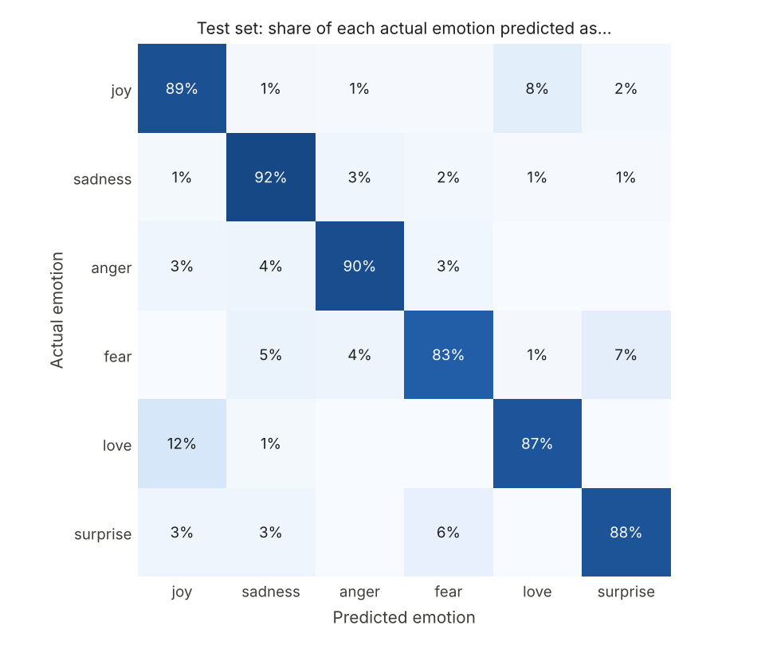

# Mood Detector

An NLP app that reads a short message and predicts the emotion behind it:
**anger, fear, joy, love, sadness, or surprise**.

Built as a team project by **Calvin Rutherford** and **Taylor Unger**
(original repo: [calvin-rutherford/mood-detector](https://github.com/calvin-rutherford/mood-detector)).
Retrained and evaluated on the 20,000-sentence
[dair-ai/emotion](https://huggingface.co/datasets/dair-ai/emotion) dataset by Taylor Unger.

## Results

| Version | Training data | Test accuracy | Test macro F1 |
|---|---|---|---|
| v1 baseline (`train_baseline.py`) | 300 hand-labeled sentences | ~0.37 | ~0.34 |
| **v2 (`train.py`)** | **18,000 sentences (dair-ai/emotion)** | **0.893** | **0.854** |

Same model design in both versions. Going from 300 to 18,000 training examples
is what took macro F1 from about 0.34 to 0.85. v1 is scored on its own small
held-out split, v2 on the official 2,000-sentence test set.

Per-emotion F1 on the test set: sadness 0.93, joy 0.91, anger 0.89, fear 0.86,
love 0.78, surprise 0.75.



The model's main mistakes are **love vs. joy** (12% of "love" sentences are
predicted as joy) and **surprise vs. fear**. Both pairs share a lot of
vocabulary, and love and surprise are the two rarest classes in the data.

## How it works

1. **Data**: dair-ai/emotion, 16,000 train / 2,000 validation / 2,000 test
   sentences, each labeled with one of six emotions.
2. **Features**: TF-IDF over single words and word pairs, with English stop
   words removed and sublinear term frequency.
3. **Classifier**: logistic regression with balanced class weights, so the rare
   emotions (surprise is under 4% of the data) are not drowned out.
4. **Tuning**: the regularization strength and n-gram range were chosen on the
   validation set only. The final model is trained on train + validation and
   scored once on the untouched test set.
5. **App** (`app.py`): a Streamlit page where you type a message and see the
   predicted emotion with its top probabilities.

## Run it

```bash
pip install -r requirements.txt
python train.py          # downloads the dataset, trains, writes results/
streamlit run app.py     # trains automatically on first launch if needed
```

`train.py --data-dir <folder>` trains from local `train.txt`, `val.txt` and
`test.txt` files in `text;label` format instead of downloading.

## Next steps

- Fine-tune a transformer (DistilBERT) and compare it with this baseline.
- Deploy the app on Streamlit Community Cloud.
